<p align="center">
  
</p>

<p align="center">
  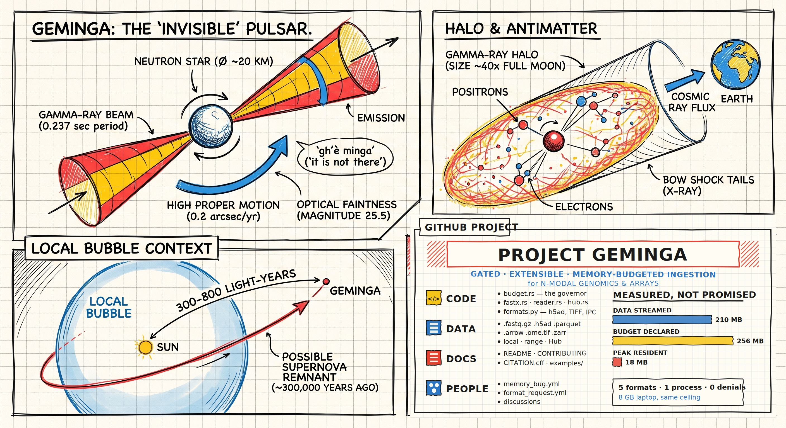
</p>

<p align="center">
  <b>G</b>ated, <b>E</b>xtensible, <b>M</b>emory-budgeted <b>I</b>ngestion for <b>N</b>-modal <b>G</b>enomics and <b>A</b>rrays
</p>

<p align="center">
  <a href="#install"></a>
  <a href="LICENSE"></a>
  
  
</p>

**Stream any omics dataset through a memory budget you set** — and navigate it like a map:
zoom, pan, select an interval, search it, and be told what each move costs *before* anything
loads. Declare the bytes; GEMINGA derives the chunking, enforces the ceiling, and blocks
rather than over-committing.

Built for **resource-aware PhDs** — the ones who know exactly how much RAM they have, because
they have had to. Constraints are a given, not a defect: a laptop, a shared node with a quota,
a GPU with 8 GB, a disk that will not hold the dataset. GEMINGA treats the budget as the input
rather than the thing you discover when the kernel kills your job.

Named for Geminga, the pulsar in Gemini. Its discoverer Giovanni Bignami picked a name that
works twice over: a contraction of *Gemini gamma-ray source*, and *gh'è minga* — "it's not
there" in his native Milanese. A source that reads as absent while streaming steadily is a
fair description of a dataset you never download. The mark is its beam, broken into chunks.

> Figure notes: Geminga spins every 0.237 s, sits at roughly 815 light-years (250 pc, with
> older parallax work putting it nearer 500), shines at visual magnitude 25.5, and has a
> spin-down age near 340,000 years. The "300–800 light-years" in the panel is on the low
> side; ~800 is the current best estimate.

```python
import geminga as g

budget = g.Budget(ram="6GB", vram="4GB", spill="100GB")

for batch in g.open("org/dataset", budget=budget):        # remote Parquet, range-streamed
    ...
for chunk in g.open("reads.fastq.gz", budget=budget):     # FASTQ, parsed in Rust
    ...
for block in g.open("atlas.h5ad", budget=budget):         # scRNA/scATAC, CSR row blocks
    ...
for tile, win in g.open("slide.ome.tif", budget=budget, overlap=64):
    masks.write(model(tile), win)                          # never holds the whole slide
```

## What is actually different

Existing streaming APIs stream in **examples** — `batch_size`, `buffer_size`, both counted in
rows. Nothing tells you, or enforces, how many *bytes* are resident. On a 96 GB workstation you
never notice. On a 16 GB laptop you find out when the kernel kills the process.

GEMINGA inverts that: **you declare the bytes, the library derives the chunking.** Every reader

1. produces a **plan** before reading anything — chunk count, resident bytes per chunk,
2. **acquires** from a tier before materializing a chunk,
3. **releases** when the consumer asks for the next one.

Requests that can never fit fail immediately with a message naming the fix. Requests that merely
don't fit *right now* block until something releases. Three tiers: `ram`, `vram` (accounting for
memory you allocate via torch/cupy — GEMINGA refuses to let you over-commit it), and `spill`.

## Stereo-seq

Stereo-seq is the case this was designed around: a 1 cm chip carries 400 million nanoballs at
500 nm pitch, chips run to 13 x 13 cm, and the paired ssDNA image is gigapixel.

**The GEF bin pyramid is the zoom stack.** SAW already writes `bin1` through `bin200` into one
HDF5 container — each a complete matrix at a coarser binning. Zooming out is not decimation; it
is switching to a level the instrument's pipeline already computed.

```python
v = g.open_gef("chip.gef", budget=g.Budget(ram="512MB"))
v.select(12000, 16000, 9000, 13000)   # chip coordinates
v.auto_bin()                           # finest bin that fits the budget
v.select_genes(["Gapdh"])              # a contiguous slice, not a scan
```

| zoom | bin | observations | resident |
|---|---|---|---|
| 0 | bin1 | 2,946,567 | 28.1 MB |
| 3 | bin50 | 1,017,051 | 9.7 MB |
| 5 | bin200 | 116,221 | **1.1 MB** |

**One gene is one slice.** Each level's `gene` dataset stores `(gene, offset, count)` into
`expression`, so a per-gene query is a contiguous read. At bin10: all 300 genes = 2,560,898
observations in 0.99 s; one gene = 14,893 observations in 0.007 s — **139x faster**, and the
unwanted rows never enter memory.

**Expression and morphology share one window.** `StereoSeqDataset` holds the GEF and the
registered image together, so one selection drives both.

```python
ds = g.open_stereoseq(gef="chip.gef", image="chip_ssdna.tif", budget=b, image_scale=0.512)
pair = ds.paired((1800, 3000, 1600, 2800))     # aligned expression raster + morphology crop
g.render.chip(ds, window=(1800, 3000, 1600, 2800), genes=["Gapdh"], path="chip.png")
```

<p align="center">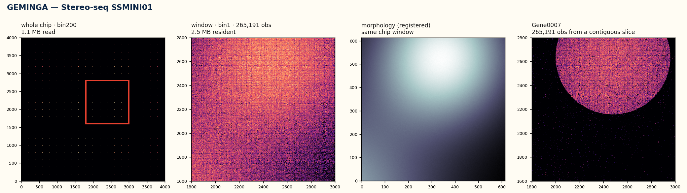</p>

GEM text matrices get the same navigation from an index GEMINGA builds itself — Rust parsing,
dictionary-encoded gene names, a spatial density grid and per-gene totals in one pass.

## Honest status

[docs/honest.md](docs/honest.md) says what this library is and is not — synthetic spatial
fixtures, no real SAW/Space Ranger/Xenium output yet, Linux-only wheels, a cooperative GPU
server — before anyone adopts it. Read that first.

## The standard pipeline, out of core

```python
pp = g.prep("atlas.h5ad", budget=g.Budget(ram="4GB"))
pp.qc().filter_cells(min_genes=200, max_pct_mito=20).filter_genes(min_cells=3).hvg(n_top=2000)
res = pp.pca(n_comps=50, out="X_pca.npy")          # three passes; nothing larger than a block resident
adata = res.to_anndata()                           # obs, var, obsm['X_pca'] — scanpy from here
```

QC, filters, normalisation with log1p, Seurat-flavour HVGs and an *exact* PCA from the HVG
covariance accumulated in one pass — checked against a dense computation and against scanpy
1.11. 200 k cells × 20 k genes under a 512 MB budget in 15 s; a 2 M-cell atlas is ten times the
time, not ten times the memory. What comes after — neighbours, UMAP, Leiden — runs on cells × 50.

## Compressed blocks and a shared GPU

```python
st = g.compressed_store(budget, "ram")             # or tier="vram", device=wgpu_device
st.put("blk0", X)                                  # packed bytes leased; 4–10x smaller for counts/indices
with st.get("blk0") as X: ...                      # raw bytes leased only while held
with st.get_device("blk0") as da: ...              # decoded on the GPU by one thread per block

res = g.reserve("http://gpu-server:8765", vram="4GB", user="seb")   # a slice of a shared card
store = res.store(device=wgpu_device)              # a CompressedStore inside the slice
```

The reference codec packs 32-bit integers per block of 128 (frame of reference or zigzag
delta), decoded by a WGSL kernel that is bit-exact against the numpy decoder. Your own
compressor plugs in through four methods and a conformance test — `g.check_codec(codec)` —
or a `geminga.codecs` entry point; `examples/plugin_codec.py` is the template. Packed tables
register as DuckDB views. The reservation server hands out VRAM in bytes with leases that
expire, reclaims idle slices when someone waits, and caps a user's share while others queue;
`python -m geminga.reserve --serve --device gpu0=24GB`.

## Contracts other tools rely on

HyVESTA, PRISM, BELLATRIX and POLARIS build on three parts of GEMINGA that are contracts, not
conveniences (see [docs/interop.md](docs/interop.md)):

- **`obsm` embeddings stream.** `g.open("atlas.h5ad", obsm="X_geneformer")` or
  `"atlas.h5ad::obsm/X_geneformer"` — same chunk dict as `H5adReader`, barcodes as `obs_names`,
  dense and CSR. Measured under a 64 KB budget: the lease held equals the block, zero denials.
  Adding it exposed a latent bug in every reader — a 1 MB chunk floor that could exceed a small
  budget — now capped at what is free.
- **The catalog is frozen and versioned.** Every event carries `geminga.catalog/1`;
  `CatalogEntry.SCHEMA` types each field; `validate()` checks a file. Facets use a fixed
  vocabulary (organism, tissue, assay, disease, sample, donor, condition, platform) and a typo
  in a key raises rather than silently losing data.
- **Harvest entries carry `kind` and `stat`.** `add_table()` writes a table you already hold with
  the same checksum and dispatch as a cut region, so HyVESTA writes *through* `Harvest`.
  Schemas `geminga.harvest/2` and `geminga.dispatch/2`, additive; `/1` files still load. A built
  puzzle adds kinds `piece` and `piece-table` and a `geminga.blueprint/1` provenance file.

## The orchestrator — datasets out of descriptions of datasets

Most of a project's data is *gh'è minga*: a row in an inventory, an accession in the notes,
"raw reads under dbGaP". The orchestrator treats every row as a **piece** and the project as a
**puzzle**, and gives four verbs that never move a byte they were not asked to.

```python
orc = g.orchestrator(catalog=g.catalog("~/inokan/catalog.jsonl"),
                     library=g.library("~/inokan/library.jsonl"), budget=g.Budget(ram="8GB"))
orc.describe("InoKAN_CD_nodes_3_culture_organoids.xlsx", sheet="Datasets")   # 56 rows → pieces
orc.learn_genes(same_xlsx, sheet="Nodes", symbol="primary_gene", members="human_genes",
                ensembl="ensembl_human (Geneformer key)", aliases=("node_id",), group="node_id")
orc.resolve(search_dirs=["/mnt/nas/inokan"])   # here / one fetch away / behind a DAC / paper only
orc.print_report()
orc.annotate()                                  # catalog facets per piece; need-data flags per hole
orc.coverage(genes=core_nodes, key="group").print()      # P protein · X perturbed · F focus · R measured
bp = orc.blueprint("cd-core", key="ensembl", panel=orc.harmonizer.genes.expand(core_nodes, "ensembl"))
puzzle = orc.build(bp, "~/handoff/cd-core")     # local pieces aligned and streamed; holes written down
```

- **Describe** reads CSV, a workbook tab, Parquet, JSONL or dicts in whatever columns the author
  used, and pulls accessions out of *every* text cell — 141 from the 56 InoKAN rows: GEO, SRA,
  BioProject, EGA, dbGaP, ArrayExpress, Zenodo, figshare, Single Cell Portal, DUOS, CNGB, DOIs.
- **Resolve** prices each piece through `acquire` without transferring anything, keeps the
  controlled-access components of open pieces, and tells a row that names a host without a record
  apart from a row that says nothing.
- **Harmonise** — `Vocabulary` (facet synonyms, extensible), `GeneMap` (symbol ↔ Ensembl ↔ Entrez
  ↔ UniProt ↔ CD designation ↔ mouse ortholog, complexes expanded to members, matrices aligned on
  one key with a loss report), `ColumnMap` (`patient_id` is a donor, `sgRNA` a guide).
- **Coverage** recomputes a gene × dataset evidence matrix from the descriptions; on the InoKAN
  workbook it agrees with the hand-built `Node_x_Dataset` sheet in 159 of 164 coded cells and
  names the two aliases (`CD8`, `PD-1`) it could not place.
- **Build** streams `.h5ad`, Cell Ranger `.h5` and mtx triples under the budget into one
  `Harvest` — COO per piece against shared `obs`/`var` — plus `blueprint.json`: the source row,
  checksum, alignment loss, obs mapping and peak bytes per piece, and every hole with its route
  and price. A build with only holes is a valid artifact: it is the shopping list.

<p align="center">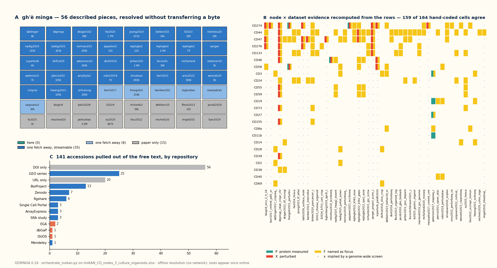</p>

## The library — flag anything, with its own coordinates

```python
lib = g.library()
g.flag_variant("chr7", 55191822, "T", "G", rsid="rs121434568", genes=["EGFR"], lib=lib)
g.flag_sequence("AGATCGGAAGAGCACACGTC", name="adapter read-through", lib=lib)
g.flag_cells(barcodes, source=h5, name="sgEGFR cells", lib=lib)
g.flag_values("culture.parquet", "t", t0, t1, "O2 dip", where=("o2_percent", "<", 8), lib=lib)
lib.query(gene="EGFR"); lib.query(locus="chr7:55.0M-55.3M"); lib.related(record)
```

Regions, time-series values, loci, SNPs, sequences, cell sets and gene lists in one append-only
library. Coordinates are stored with their convention — VCF positions stay 1-based, loci are
entered as browsers print them and stored 0-based half-open, builds are normalised — so nothing
is off by one later. Records go through `open → in-review → confirmed | refuted → resolved` with a
full history; any metadata is queryable; `related()` links records across kinds by shared genes,
overlapping loci and explicit links. More data is found per kind: sequences in your other FASTQ
files and via BLAST, variants in Ensembl, ClinVar and dbSNP, genes in the datasets you hold.
Exports: Polars frame, BED6 for IGV, GeoJSON, and a dispatch file for PRISM.

<p align="center">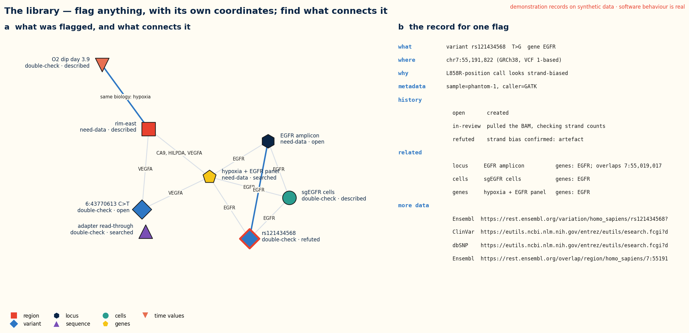</p>

## The journal — every piece streamed, with its exact coordinates

```python
v = g.open_gef("chip.gef", budget)                        # "open": extent, bin levels, gene list
v.select(1600, 3000, 1400, 2100).use_bin(50).load()       # "load": file, bin, exact window, rows, bytes
j = g.journal()                                           # ~/.geminga/journal.jsonl, plain JSONL
j.search("GFAP", overlaps=(1000, 2000, 1000, 2000))       # text + the predicates grep cannot do
v2 = j.replay(j.tail(1)[0])                               # the very same piece, reopened
j.datasets(); j.visited(v); j.coverage(v)                 # per chip: pieces, windows, where nobody looked
```

Every `load()`, chunk stream, overview, `read_window`, `rasterize`, `select` and `similar` appends
one record — half-open window in the dataset's own coordinates, level, dataset key with the
file's fingerprint, rows, bytes, seconds, and who asked (the explorer's frame, a selection being
described, a region being extracted or handed off). The first opening of a chip records its gene
list, so `rg GFAP ~/.geminga/journal.jsonl` says which chips you ever opened carried the gene,
including ones that were on an FTP server you can no longer reach.

Search it with `grep`/`rg` on the file, with `Journal.search` (text, overlap, time, dataset,
selection), with DuckDB, or through the trigram index `j.index()` builds in the Rust core in the
shape of Microsoft's tgrep — blocks of lines, posting lists, a query touches only the blocks that
hold all of its trigrams; a rare term answers in 3 ms on a journal of a million records (ripgrep:
174 ms), a term found everywhere falls back to the scan ripgrep does faster. `python -m geminga.journal
tail|grep|datasets|where|coverage|index`. `GEMINGA_JOURNAL=0` turns it off. `docs/journal.md`.

## Selections — mark it, measure it, find more like it

```python
book = g.selections()
sel = g.select(view, "rim-east", box, intent="need-data", book=book)   # or s in the explorer
g.describe(sel, view)      # VEGFA +4.2 (2,787 vs 156 expected) … SNAP25 0 vs 2,211
g.similar(sel, view)       # distinct places elsewhere that look like it
g.leads(sel, context=["glioblastoma"], local=vault_paths)   # data you have, and don't
```

Rectangles, polygons, intervals, and value ranges on a column — so a time window is a selection
too. The book is append-only JSON lines keyed by dataset fingerprint, readable by PRISM, exportable
as GeoJSON. On the glioma phantom a marked rim patch returned six candidates all on the same ring;
on a culture series with four planted hypoxic episodes, marking one found the other three
(0.74–0.87, next best 0.36). `leads()` reports which local datasets measured the enriched genes and
builds GEO, PubMed and ENA queries whose accessions feed straight into `acquisition_plan()`.

<p align="center">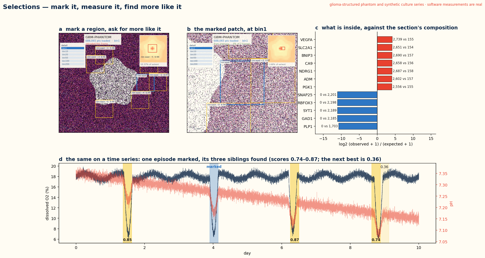</p>

## Datasets too big to download

A CNGB project's suggested fetch is `wget -r` of the whole tree. For terabytes that is the wrong
first step: it needs the disk and moves everything before you know which files you want.

```python
tree = g.list_tree("ftp://ftp.cngb.org/pub/CNSA/data2/CNP0002646/CNS0513001/")
g.print_tree_summary(tree)            # sizes by type, from directory listings alone
g.fetch_selected(tree, include=["*.gef"])["commands"]     # one wget per file, not a mirror
v = g.open_remote_gef(url, budget=b)  # the GEF stays on the server
```

`RemoteFile` reads through FTP `REST` offsets or HTTP `Range` with a bounded, budget-reserved
block cache; h5py opens a GEF through it. On a 25 MB GEF over FTP: opening cost 7 MB, a bin1
window without an index cost the whole level, and after one 15 MB pass to build a local spatial
index the same window cost 0 B and matched a local read exactly. Stated plainly: fine work on one
chip still reads most of that chip once — the saving is against the project, not the file.

## A window costs what is in it

A GEF stores each level in *gene* order — which is what makes a single-gene query one slice — so a
spatial window used to read the whole level and filter. `cost()` reported the rows kept and said
nothing about the bytes read. `GefFile.build_spatial_index()` writes a second copy of each level
sorted by **Z-order**, so fixed-size row groups cover compact patches of the chip and the Parquet
pruner already in the Rust core can skip every row group whose box misses the window. It is built
out of core: one gene slice at a time, then a Polars streaming sort.

| window | read time before → after | compressed bytes read |
|---|---|---|
| whole section | 246 → 121 ms | 11.6 → 10.3 MB |
| 1.6 % | 205 → 9 ms (**22×**) | 11.6 → 0.78 MB |
| 0.1 % | 196 → 4 ms (**49×**) | 11.6 → 0.35 MB (**33×**) |

Identical observations either way, checked as multisets. `cost()` now reports `read_bytes`
beside `resident_bytes`, and says when no index exists.

<p align="center">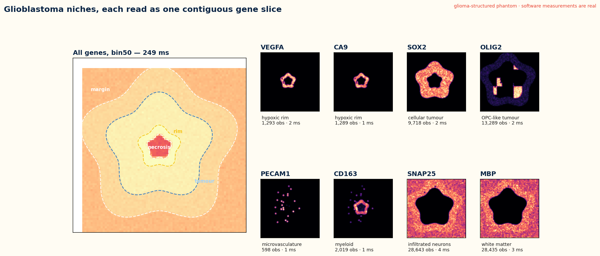</p>

Two rendering fixes came out of the poster work: points are **aggregated per location** before
drawing (a GEF holds one observation per gene per bin, and drawing each copy made the section
look like noise), and the shader enforces a **minimum on-screen point size**, so bin1 at deep zoom
reads as tissue rather than speckle.

## Interactive navigation

```python
ex = g.explore("chip.gef", budget=g.Budget(ram="2GB"))
ex.run()          # drag, scroll about the cursor, g cycles genes, b/r bookmark and recall
```

The explorer's one real job is deciding **when a frame needs I/O**. It loads a margin around
the view and serves every frame it can from memory, reloading only when you leave the loaded
area or zoom far enough to change rung — with hysteresis, so a zoom hovering near a boundary
does not thrash. A recorded 21-frame session: 6 reloads, 71 % served from memory, peak 11.6 MB.

<p align="center">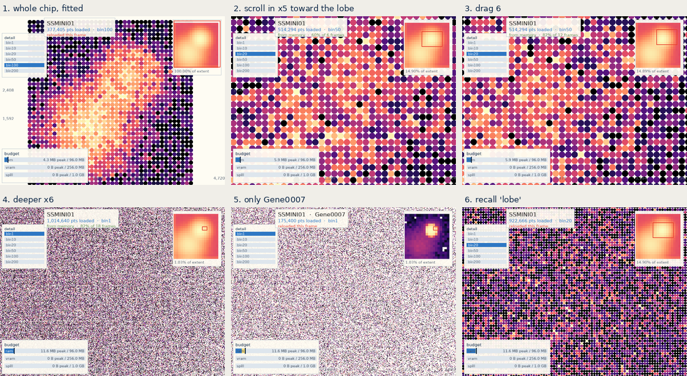</p>

A margin buys smooth panning but quadruples the loaded area, which forces a coarser rung — so
the margin is adaptive, and how far it may shrink is a named policy. Measured on one session:
`smooth` 3/17 frames at bin20 or finer, `balanced` (default) **6/17 at the same I/O**, `sharp`
13/17 at five times the I/O. Everything runs headless — `record()` plays a scripted session and
returns frames; `run()` feeds real mouse events into the same `handle()`.

Images go to the viewers that already exist: `g.to_ome_zarr()` writes NGFF v0.4 that napari,
neuroglancer and Vitessce stream lazily. For a GEF, SAW's bin levels *become* the NGFF pyramid —
nothing downsampled — and for images the `band` size is a ceiling, not a suggestion.

## Polars and the wgpu stage

Arrow is already the currency, and **Polars** is Arrow with a Rust engine — so `view.polars()`
is a pointer move, not a copy. GEMINGA keeps the part Polars has no way to do (pricing a
selection from footers, over HTTP range requests, before fetching) and hands Polars the part it
does best:

```python
lf, plan = xenium.lazy_window(1000, 1400, 500, 900, explain=True)
plan["row_groups_kept"], plan["selectivity"]   # 2 of 20, 10.0 % — GEMINGA decided
lf.collect()                                    # 2,341 rows — Polars executed
```

`g.sink_parquet()` streams results larger than memory; `Catalog.polars()` reads the log.
One boundary detail is handled explicitly: Polars uses `large_string`, so `from_polars()`
narrows types back by default rather than silently widening a `Harvest` schema under the R and
Ruby readers.

The **stage** is a small wgpu canvas — two pipelines, one draw call each:

```python
st = g.Stage(900, 700, point_budget="16MB")
st.show(view)          # asks cost(), coarsens the bin/stride until it fits, then loads
st.axes(); st.label("GBM chip", 14, 14, scale=1.3)
st.render_png("chip.png")
```

Points are instanced quads coloured through a LUT texture; text comes from a glyph atlas in
screen space, so labels keep their size as you zoom. The renderer never decides how much to
read — on a 2.9 M-observation chip it chose bin200 at a 2 MB point budget and bin1 at 64 MB,
with draw calls flat at 2 throughout. Headless on a software adapter, so it runs in CI; `wgpu`
is imported lazily, so `import geminga` still works on a machine with no graphics stack.

`st.hud(view, budget=b)` adds a **minimap** (the whole dataset with your window outlined, built
from the coarsest level so it costs the same at any depth), a **detail ladder** showing which
rung of the pyramid is on screen, and **budget gauges** with capacity as the track, the peak as
a ticked fill, and current use as the solid bar. Panels register the screen space they occupy
so axis ticks skip out of the way.

<p align="center">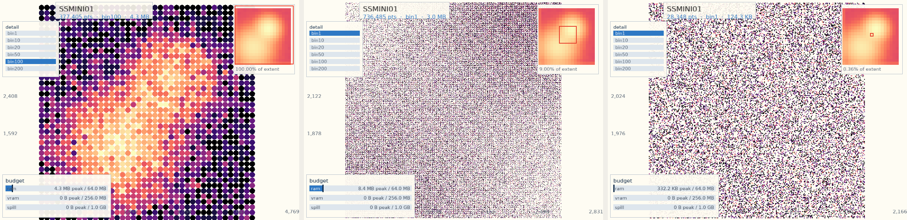</p>

Whole chip at bin100 (4.3 MB), a 30 % window at bin1 (8.4 MB), a 6 % window (332 KB). Pass
`workspace=ws` instead and the gauges become one bar per cell — partition reserved against peak
reached.

<p align="center">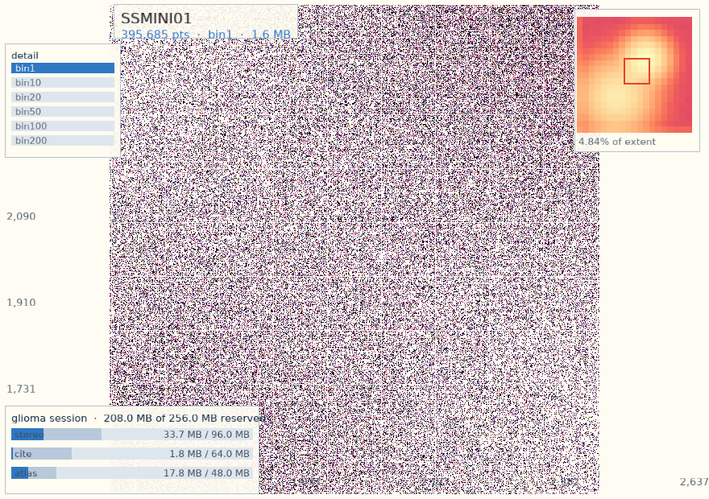</p>

## Multi-modal single-cell and spatial — the 10x family

A 2025–26 glioma atlas ships as a Cell Ranger, Space Ranger or Xenium Ranger *directory*.
The `feature_type` column in a 10x matrix names the modalities stacked in it, and GEMINGA
slices them as contiguous row ranges — the same trick as the Stereo-seq gene index.

```python
g.modalities("sample_01/").print()        # headers only: cells, RNA / ADT / GUIDE / Peaks, image
m  = g.TenXMatrix("filtered_feature_bc_matrix.h5")
m.block(0, 500, "ADT")                    # 40 antibody rows x 500 cells, nothing else read
gv = g.open_tenx(path, modality="GUIDE")  # a CRISPRi screen's guide counts, navigable

vb = g.open_visium("spaceranger_out/")    # matrix + tissue_positions + scalefactors + image
vb.in_window((1500, 2500, 800, 1600))     # spots inside a pixel window, from positions alone
xb = g.open_xenium("xenium_out/")         # transcripts.parquet pruned by x_location
mc = g.MultiChannelTiff("codex.ome.tif"); mc.channel("GFAP", 600, 1000, 500, 900)
```

MatrixMarket triples stream but cannot be navigated; `MtxTriple.to_h5()` converts once. CosMx
and MERFISH CSVs are recognised, sized, and pointed at a one-time Parquet conversion. Twenty-four
of thirty rows in a glioma inventory open natively; the six that do not — MSI, Raman, long-read
DNA, mass-spec proteomics — are not large-matrix problems and are said so.

The [CRISPR one-pager](docs/crispr.md) describes what a perturbation index and a
`PerturbView` would add; the [wet-lab brainstorm](docs/wetlab.md) is honest about where a data
layer fits in a glioma paper: in the methods, as provenance, not as the finding.

## MRI volumes

Lesion-segmentation cohorts — MSLesSeg, ISBI 2015, MSSEG, the WMH challenge — are volumes,
not matrices: NIfTI or DICOM, several sequences per session, several sessions per subject, an
expert mask alongside. GEMINGA reads them lazily in the axis that matters.

```python
v = g.view("P01_T1_FLAIR.nii.gz", budget=b)   # 352-byte header now, voxels on demand
v.select_frac(0.25, 0.75).zoom_in(2)          # 3-D window, one pair applies to all axes
for slab, window in v.chunks():               # slab-wise, budget-sized
    sink.write(model(slab), window)           # MaskSink3D -> Zarr -> to_nifti()

co = g.Cohort("MSLesSeg/train")               # subjects x sessions x sequences
co.longitudinal(); co.with_mask(); co.complete(("T1w", "T2w", "FLAIR"))
co.paired_windows("P01", "MASK")              # the same window across timepoints
```

DICOM series are catalogued from headers alone (`stop_before_pixels=True`) and ordered by
physical slice position. A gzipped NIfTI cannot be seeked, so `cost()` reports the linear read
separately from the bytes kept. OpenNeuro is in the AWS Open Data Program — free — and its BIDS
layout is one `Cohort` reads directly.

**A review finding fixed in v0.7:** `View.load()` gated on the budget but never *reserved* it,
so peak stayed at 0 B across every view since v0.2. Every view now holds a lease for what it
last returned, released on the next call, on `release()`, or on leaving a `with` block.

## Getting hold of the data without paying twice

GEMINGA does not download — `fasterq-dump`, `ascp`, `fastq-dl`, `pyega3` and `aws s3` exist and
a worse one would help nobody. What is missing is the step before: **which route, what it
costs, and whether the transfer is needed at all.**

```python
p = g.acquisition_plan("SRR1448774")
print(p.explain())
```

```text
SRR1448774  (sra_run)
  2 file(s), 2.4 GB total
  ena-http     2 file(s)   2.4 GB   free   streamable
               EBI mirror of SRA, already converted to FASTQ
  ena-aspera   2 file(s)   2.4 GB   free   install ascp
  aws-odp      1 file(s)      0 B   free   AWS pays under the Open Data Sponsorship Program
  -> take ena-http and inspect it in place before transferring anything
```

**ENA mirrors SRA and serves FASTQ free** — FTP, HTTPS and Aspera, already converted, no
`fasterq-dump` step. A metered cloud route for the same bytes is almost always avoidable:

| volume | ENA / AWS Open Data | AWS requester-pays | GCP requester-pays |
|---|---|---|---|
| one 10x run (2.4 GB) | **free** | $0.22 | $0.29 |
| a 58-sample LUAD atlas (180 GB) | **free** | $16.20 | $21.60 |
| a TCGA WGS slice (1.2 TB) | **free** | $108.00 | $144.00 |

### Peek before you pull

ENA, GEO and Zenodo honour Range requests, so the first slice of a 40 GB FASTQ costs a few
hundred kilobytes:

```python
g.peek("SRR1448774", n_bytes="512KB")
# {'format': 'FASTQ', 'read_length_mean': 101.0, 'gc_fraction': 0.4832,
#  'fraction_read': 0.0002, 'cost_avoided_usd': 0.0}
```

For a shortlist of two hundred candidates that is the difference between a week of transfers
and an afternoon. Recognises FASTQ, FASTA, Parquet, HDF5 (h5ad/GEF/10x), MatrixMarket,
Stereo-seq GEM, TSV and CSV; pairs with `g.profile()` to rank assay hypotheses for a dataset you
have not downloaded.

### Delegation, never reimplementation

```python
g.print_tools()                       # what is on PATH, and what each is for
g.fetch("SRR1448774", "/data")        # dry run by default — prints the exact command
```

Aspera is built as an `ascp` command with the right host, port and key: FASP is proprietary and
cannot be reimplemented, so pretending otherwise would be a lie. Dropbox share links are
rewritten with `dl=1`. Controlled access (EGA, dbGaP, GSA-Human) is reported as needing
committee approval rather than guessed around — there is no way past a DAC, and months is the
honest estimate.

## The dataset is already downloaded, and it is too big

Streaming assumes bytes are expensive to fetch. The opposite case is at least as common: the
data is on an external drive or a NAS mount, nothing needs fetching, and what is scarce is
somewhere to put the part you are working on. Three levels, each bounded, each declared:

```text
vault (slow, huge, read-only) -> staging (fast, bounded) -> device (RAM/VRAM/XPU) -> pipeline
```

```python
b  = g.Budget(ram="8GB", vram="6GB", spill="200GB")
v  = g.vault("/mnt/nas/stereoseq").scan(profile=True)   # indexed once, never copied
st = g.staging("/scratch/geminga", capacity="150GB", budget=b)

view = v.open("chip.gef", budget=g.Budget(ram="4GB")).use_bin(20)
st.extract("chip:lobe-a", view, window=(12000, 16000, 9000, 13000), pin=True)
tbl = st.read("chip:lobe-a")        # local and fast from here on
```

**Staging holds extracted regions, not file copies.** Copying a 400 GB GEF onto a 200 GB NVMe
to work on a 2 GB corner of it is the mistake this exists to prevent. A region is read through
the same windowed readers as everything else — one pass over the slow link per region, not per
look. Eviction is LRU with pinning; a region that cannot fit raises `StagingFull` naming the fix.

`v.scan(profile=True)` runs the profiler over every member, so the vault table tells you which
files are Stereo-seq, which are unsettled, and which are `oversized("16GB")` — that is, which
ones actually need this workflow. The manifest is written beside the data so the next person to
mount that drive inherits the work.

### Devices

```python
g.describe_devices()
pool = g.device_pool("cuda:0", "6GB", budget=b)
with pool.place(array) as t:
    model(t)
```

Free figures come from the driver on CUDA and XPU, not an estimate. GEMINGA does not allocate
device memory — torch or a vendor runtime does — but it refuses over-commitment and gives you
the number first. Non-GPU accelerators (Tenstorrent Tensix, NPUs) are listed `accounting_only`:
they get the bound but not the placement, because their memory belongs to their own runtime.

### Handing regions to other tools

GEMINGA moves bytes; it does not fit models or render manifolds and should not start. What it
owes a toolchain is a clean handoff — Arrow, Parquet, NDJSON or CSV plus a manifest.

```python
h = g.harvest("/scratch/handoff/ch3", note="margin survey")
h.add(view, "margin-a", fmt="parquet", targets=["regulus", "prism"])
h.add(view, "margin-b", fmt="arrow",   targets=["amethrine"])
h.write_dispatch()                      # flat, target-keyed, Perl-readable
```

Every region carries its source, window, bin level, gene selection, row count and a SHA-256;
`h.verify()` re-checks them all. Perl has no first-class Arrow reader, so `dispatch.json` is a
flat index of absolute paths and formats that an orchestrator reads with any JSON module and
acts on without understanding Arrow at all. Nothing here imports those tools or depends on them
existing — the manifest is the whole contract.

## Several datasets at once

```python
ws = g.workspace(ram="8GB", name="thesis", catalog=g.catalog())
ws.add("chip",  "run1.gef",       ram="3GB", note="tumour section")
ws.add("atlas", "reference.h5ad", ram="2GB")
ws.add("reads", "run1.fastq.gz",  ram="1GB")

ws["chip"].view.select(12000, 16000, 9000, 13000)
ws.select_frac(0.45, 0.55)     # same relative position in every cell, any dimensionality
ws.print_report()
```

Each cell reserves its slice up front, so a cell that would over-commit the workspace is
refused before anything opens. `suspend(release_reservation=True)` hands the slice back while
keeping the window, zoom, bin and gene selection; `resume()` restores them. A reader that
raises marks its own cell failed and leaves the siblings working.

**These are not containers, on purpose.** A jail isolates with namespaces, a chroot and kernel
limits. Of those, the only part GEMINGA needs is the resource limit — and the budget governor
already is one, at the cost of an atomic add. The rest would break the premise: the whole
performance argument is that a decoded Arrow batch reaches Python with no copy, and a namespace
boundary means serialization or a shared-memory handshake on every batch. A container starts in
tens to hundreds of milliseconds; navigating an index here takes under one. What is worth
borrowing is the jail's *model* — a partitioned bound, a namespace, a lifecycle, failure
containment — and all four are nearly free.

Real OS-level isolation stays available where it earns its cost, opt-in per call:

```python
n = ws["chip"].run_isolated(lambda v: len(v.load()["x"]))   # forked, under an RLIMIT_AS allowance
```

## What is this dataset?

`g.profile()` returns ranked hypotheses with the evidence behind each — not a label.

```text
data.h5ad
  format   : AnnData h5ad
  assay    :
        49%  scRNA-seq
        27%  snRNA-seq
        22%  scATAC-seq
  NOT SETTLED — scRNA-seq versus snRNA-seq.
  To decide: intronic fraction — scRNA-seq is exon-dominated (<30% intronic).
  evidence :
      [structure] AnnData layout (X/obs/var) (+3.0 -> scRNA-seq, snRNA-seq, scATAC-seq)
      [content] 20,000 observations — per-cell, not per-sample (a nucleus is a row too)
```

Two rules make that output trustworthy. Evidence that cannot separate two assays supports
**both** — "20,000 rows, so cell-level" argues for scRNA-seq and snRNA-seq equally, because a
nucleus is a row too. And `confident` is False unless something from metadata, content or the
source page actually discriminated: a container tells you the format, never the assay. A `.h5ad`
is equally an scRNA-seq or an snRNA-seq file, and a tool that prints one of those names with no
hedging is lying to a student who does not yet know to doubt it.

Evidence comes from container structure, pipeline metadata, content statistics, and — when a URL
is given — a keyword grep of the source page, which is frequently the only sc/sn signal there
is. LDA was considered for that last step and rejected: it needs a corpus to fit and yields
topics that need naming, where here there is one document and a known vocabulary. A weighted
keyword score is transparent and auditable; embedding similarity is the upgrade path when a
corpus exists.

## Keeping track, and a small optional assistant

```python
cat = g.catalog("~/.geminga/catalog.jsonl")
cat.record("chip1", "run1.gef", url=..., profile=p, note="tumour section")
cat.annotate("chip1", tags=["thesis", "ch3"])
cat.print_table()
cat.unsettled()          # what automated profiling could not pin down

ai = g.assistant()                        # probes localhost, falls back to offline prose
print(ai.explain_protocol("snRNA-seq"))   # ~300 words plus places to read further
```

Append-only JSONL, because a text log survives a corrupted index and a version bump; DuckDB is a
query surface over the same file rather than the storage itself.

GEMINGA ships **no inference engine** — vendoring one would add gigabytes of weights and a CUDA
or Metal build dependency to a library whose premise is that the machine is small. The assistant
is a thin adapter over an OpenAI-compatible endpoint (**mistral.rs**, llama.cpp, vLLM, LM Studio),
Ollama, or a `template` fallback carrying checked offline prose, so nothing here ever *requires*
a model. mistral.rs is the natural pairing for a Rust-core project; note that `rustformers/llm`
is archived and should not be built on.

## Navigate before you load

```python
v = g.view("reads.fastq", budget=b)     # one indexing pass; after that navigation is free
g.print_cost(v)                          # window 0-200,000 · 63.8 MB · .load() fits
v.zoom_in(4, center=125_000)             # like a map: resolution rises as the window narrows,
g.print_cost(v)                          #   so the cost stays flat while you move
v.select_frac(0.55, 0.60).auto_zoom()    # or: pick the coarsest level that fits, automatically
print(v.overview().sparkline("gc"))      # ▇▃▆▇▇▄▅▆▆▅▄▇▅▅▆▆▆▅▄▆▆▆▇▆▅▅▅▆▆▇
data = v.load()                          # budget-enforced; raises CostError with the fix
g.render.navigator(v, "nav.png")         # overview + window + detail + cost, one figure
```

**Zoom is resolution, not just extent.** Zooming out loads a *coarser* view of a wider span, so
every level costs about the same to draw. Measured on a 200k-read FASTQ:

| move | window | zoom | stride | records | resident |
|---|---|---|---|---|---|
| start | 0–200,000 | 4 | 16 | 12,500 | 4.0 MB |
| `zoom_in(4)` | 100,000–150,000 | 2 | 4 | 12,500 | 4.0 MB |
| `zoom_in(4)` | 118,750–131,250 | 0 | 1 | 12,500 | 4.0 MB |

Decimation keeps distributions honest — GC across a 64× stride range moves from 0.5000 to
0.5008.

**Cost is answered from metadata.** `cost()` separates two questions that are usually confused:
`fits` (can this be streamed one chunk at a time) and `fits_whole` (can `.load()` hand you all
of it). When the answer is no, the error says what to change:

```
CostError: the window holds 65.3 MB at zoom 0 but 16.0 MB is free; zoom out 3 level(s),
narrow the window to ~24% of its span, stream it with .chunks() instead of .load(),
or raise the 'ram' budget
```

`auto_zoom()` then lands inside the budget on its own — 128 MB → zoom 0, 16 MB → zoom 3,
512 KB → zoom 8.

<p align="center">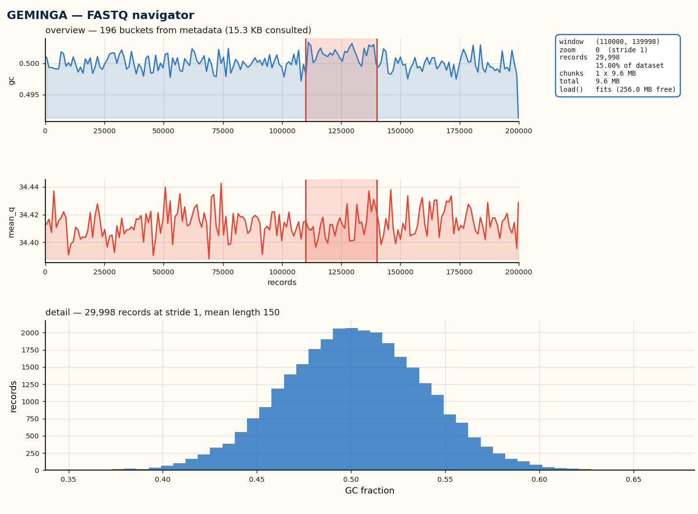</p>

### The index that makes it free

A sequence file gets one pass; everything after is arithmetic. For a 61.7 MB FASTQ the sidecar
is **35 KB (0.054%)**, and re-aggregating it to any zoom level takes **under a millisecond**.
It also stores byte checkpoints, so `cost()` reports where a seek would start and how many
records it would have to skip. Parquet needs no sidecar at all — row-group statistics already
carry the overview — and h5ad gets it from `indptr` for free.

## Search that skips what it can prove it does not need

Two mechanisms, one idea: decide from cheap metadata what *could* match, fetch only that.

**Parquet — predicate pushdown.** Footer min/max rules out whole row groups before a byte of
data leaves the server. The honest caveat is that this pays off exactly as much as your data is
clustered:

| same 2M rows | row groups kept | bytes fetched | selectivity |
|---|---|---|---|
| unsorted | 20/20 | 9.7 MB of 9.7 MB | 100% |
| sorted by `x` | 2/20 | 497 KB of 5.3 MB | **9.2%** |

**Sequences — multi-pattern SIMD.** Aho-Corasick matches every pattern (and, optionally, every
reverse complement) in one pass, so 300 adapters cost about what one costs. On a 200k-read
FASTQ with adapter read-through seeded into records 110,000–140,000:

```
13,486 hits in 13,486/200,000 records, 30 Mbase in 0.38s (80 Mbase/s)
density: ▁▁▁▁▁▁▁▁▁▁▁▁▁▁▁▁▁▁▁▁▁▁▁▁▁▁▁▁▁▁▁▁▁█████████▁▁▁▁▁▁▁▁▁▁▁▁▁▁▁▁▁▁
inside that band: 45.0% of reads carry the adapter — outside it: 0
```

<p align="center">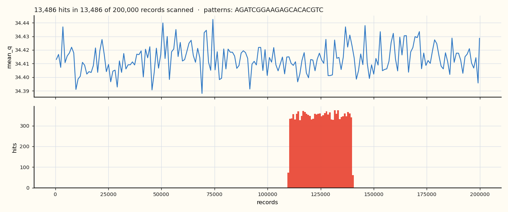</p>

## A picture that builds while it streams

`ProgressiveCanvas` takes its bounds from column statistics (free), then histograms each batch
into a fixed grid — so it is O(grid), never O(rows). 2,000,000 rows through a 400×400 canvas
stays at **2.4 MB resident** from the first batch to the last, and is drawable at any moment.

<p align="center">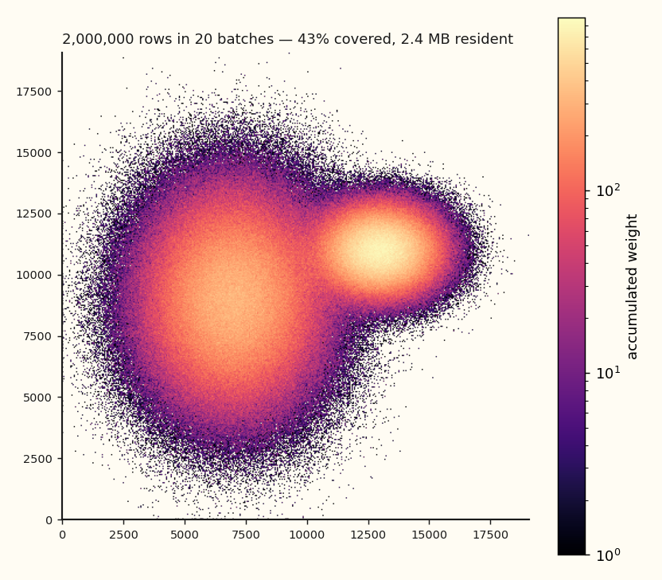</p>

## Formats

| Format | Backend | Chunk unit | Notes |
|---|---|---|---|
| NIfTI / NIfTI.gz | Python — `nibabel` | slabs (Z, Y, X) | header-only open; gzip reads are linear and costed as such |
| DICOM series | Python — `pydicom` | slice files | headers only until pixels are asked for; ordered by physical position |
| Stereo-seq GEF | Python — `h5py` | bin level + spatial window | `bin1`…`bin200` are the zoom levels; gene index gives contiguous slices |
| Stereo-seq GEM | Rust | byte-sized row runs | dictionary-encoded genes; spatial index sidecar |
| Parquet (local, HTTP, HF Hub) | Rust — `arrow`/`parquet` + `object_store` | row groups | HTTP range requests; footer-only inspection reads ~0.3 % of a file |
| FASTA / FASTQ (`.gz` ok) | Rust — `needletail` | byte-sized record runs | ~680 MB/s plain, ~90 MB/s gzipped, single core |
| h5ad (scRNA-seq, scATAC-seq) | Python — `h5py` | CSR row blocks (cells) | block size derived from `indptr`; CSC rejected with a fix |
| Arrow IPC / Feather | Python — `pyarrow` | record batches | memory-mapped |
| TIFF / OME-TIFF | Python — `tifffile`, native tile reader | image tiles, optional overlap | decodes only the tiles a window touches; no zarr dependency |
| Zarr / OME-Zarr | Python — `zarr` | image tiles | |

Everything tabular arrives as a zero-copy `pyarrow.RecordBatch`; imaging arrives as `numpy`.

## Measured

One 256 MB budget, every format, one process (`examples/all_formats.py`):

| Input | Size | Chunks | Peak resident |
|---|---|---|---|
| `reads.fastq` (200k reads) | 61.7 MB | 4 | 18.0 MB |
| `reads.fastq.gz` | 28.6 MB | 4 | 18.0 MB |
| `sc.h5ad` (20k cells × 3k genes, CSR) | 24.2 MB | 3 | 8.0 MB |
| `tissue.ome.tif` (6144², uint16) | 72.0 MB | 25 tiles | 4.0 MB |

v0.9 adds `tests/test_frames_stage.py`; the suite is **198 tests**, including one asserting that
pruning never drops a row that the exact predicate would have kept.
| `test_bins.parquet` (2M rows) | 24.0 MB | 20 | 14.4 MB |

Budget high-water across all of it: **18.0 MB of 256 MB, 47 grants, 0 waits, 0 denials.**

The governor's three behaviours (`examples/budget_behaviour.py`):

- **Adaptive** — the same Parquet file at a 32 MB budget streams 8 MB chunks; at 128 MB, 32 MB chunks. Peak resident tracks the budget, never the file.
- **Backpressure** — with 20 of 24 MB held by something else, the first chunk arrives after 1.50 s instead of over-committing (`waits=1, wait_millis=1497`).
- **Fail fast** — a 64 MB chunk against a 4 MB budget raises `MemoryError: cannot fit 30.9 MB in the 'ram' tier (capacity 4.0 MB). Lower the chunk size (chunk_bytes / batch_size), or raise the budget for this tier.`

## Install

```
pip install geminga-0.18.0-*.whl                     # prebuilt, Linux x86_64, CPython 3.11
# from source (Rust >= 1.85, pip install maturin):
maturin build --release && pip install target/wheels/geminga-*.whl
```

Python extras by format: `h5py`+`scipy` (h5ad), `tifffile` (TIFF), `zarr` (Zarr, `MaskSink`).

## API

**Budget** — `Budget(ram="4GB", vram="0", spill="0", timeout_s=120)`; `.acquire(tier, size)`
returns a lease usable as a context manager; `.available(tier)`, `.stats()`, `.reset_peak()`.
Sizes parse as `"8GB"`, `"512MB"`, `"1.5GiB"`, or an integer byte count.

**Opening** — `g.open(target, budget=...)` dispatches on what the target is (Hub id, URL, or
path by extension). Explicit forms: `open_hub`, `open_urls`, `open_paths`, `open_fastx`,
`open_h5ad`, `open_arrow`, `open_image`.

**Planning** — `g.print_plan(reader)` or `reader.plan()` → `Plan(kind, n_chunks,
bytes_per_chunk, total_bytes, detail)`; `plan.fits(budget)`. For Parquet, `ds.plan(chunk_bytes,
columns)` gives rows per chunk and the projected width. Nothing is read.

**Parquet extras** (from the MEANDER core) — `ds.describe()`, `ds.stats()` (per-column min/max/
nulls from footers), `ds.schema()`, `ds.sample(n_row_groups, seed)`, `ds.materialize(path, ...)`,
`ds.transfer_stats()`.

**Sinks** — `ParquetSink(path)` appends batches without accumulating; `MaskSink(path, shape)`
writes per-tile segmentation output straight to a full-resolution Zarr array, offsetting instance
labels so ids stay unique across the image.

## Status and known gaps

The long form is [docs/honest.md](docs/honest.md). The short form:

- Every reader, view and store is tested against the one invariant — peak resident never
  exceeds the budget — on FASTQ, Parquet, h5ad, Cell Ranger h5, mtx, GEF/GEM, OME-TIFF,
  NIfTI, DICOM and the compressed store. `examples/all_formats.py` runs it end to end.
- The Stereo-seq fixtures are synthetic: the GEF reader follows the SAW format description and
  no real SAW, Space Ranger or Xenium output has been through this repository yet.
- Online paths (ENA, GEO, Zenodo, figshare, CNGB, the Hub) are tested on recorded responses;
  the build environments had no access to those hosts.
- The interactive explorer is tested headless (`record()`); `run()` has not opened a real window.
- GPU paths are bit-exact on a software adapter (llvmpipe); nobody has measured their speed on
  real hardware yet.
- The reservation server is cooperative: it governs GEMINGA's own stores and readers and makes
  the sharing visible; it cannot stop a process allocating past its grant.
- Prebuilt wheels in this repository are Linux x86_64 / CPython 3.11; the CI matrix builds
  Linux, macOS (arm64 and Intel) and Windows for Python 3.10–3.13 on every push to `main`.
- Parquet chunking is bounded below by the file's row-group size; `plan()` reports the real
  number. CSC-encoded h5ad is refused rather than silently reading every column chunk.
- Leases are released when the consumer requests the next chunk; `sample()` and `search()`
  return lists that are the caller's and are not leased.
- Shared-memory parallelism is per-chunk and I/O-side (tokio); rayon across chunks is the obvious
  next win. MPI is deliberately out of scope — the target is one laptop, not a cluster.

Apache-2.0.

## Documentation

Full docs build with Sphinx and the furo theme:

```bash
pip install -r docs/requirements.txt
sphinx-build -b html docs docs/_build/html
```

Guides for [concepts](docs/concepts.md), [Stereo-seq](docs/stereoseq.md),
[navigation](docs/navigation.md), [search](docs/search.md), [visuals](docs/visuals.md),
[formats](docs/formats.md), plus a full [API reference](docs/api.md) and
[benchmarks](docs/benchmarks.md). CI publishes them to GitHub Pages.

## Repository layout

```
src/                 Rust core — budget governor, Parquet range reader, FASTX parser
python/geminga/      Python API — dispatch, h5ad / Arrow / imaging readers, sinks
examples/            fixtures generator, per-format demos, budget behaviour demo
tests/               the invariant: peak resident never exceeds the declared budget
assets/              logo, infographic, social preview (see assets/README.md)
docs/                Sphinx site (furo theme) — guides, API reference, benchmarks
tools/               build_panel.py — regenerates the project panel of the infographic
.github/workflows/   CI: tests on 3.10/3.12/3.13, clippy + ruff, wheels for Linux/macOS/Windows × 3.10–3.13
```

## Roadmap

Done in v0.2: predicate pushdown, multi-pattern sequence search, the LOD index, zoom/pan/cost,
progressive rendering. Done in v0.3: Stereo-seq GEF/GEM/cellbin, multimodal registration,
Sphinx documentation. Done in v0.4: workspaces and cells, evidence-based profiling, the
catalog, and an optional assistant. Done in v0.5: vault, staging, device pools and
the pipeline handoff. Done in v0.6: acquisition route planning and remote peeking. Done in v0.7: MRI volumes, cohorts,
budget accounting on every view, unified version strings. Done in v0.8: 10x matrices by
feature type, Visium/Xenium bundles, multiplexed OME-TIFF, the modality overview, and a stricter
confidence rule in the profiler. Done in v0.9: Polars integration and the wgpu stage. Done in v0.10: the HUD, the
interactive explorer, and OME-Zarr export. Done in v0.11: the GEF spatial index,
per-location aggregation, minimum point size, and a glioma-structured phantom. Done in
v0.12: remote listing, selective fetch, GEFs opened over FTP/HTTP, CNGB accessions. Done in
v0.13: selections — marking, measuring, similar-region search, leads. Done in v0.14: the
library — flags of every kind with explicit coordinates, workflow, queries, links. Done in
v0.15: the HyVESTA contracts (obsm reader, frozen catalog schema, kind/stat manifests), the
chunk-floor fix, a static-analysis pass, and `__version__` from the installed distribution. Done
in v0.16: the orchestrator — descriptions to pieces, resolution without transfer, harmonisation
(vocabulary, gene map, column map), coverage, blueprints and builds with holes — plus an exact
`Dataset.search`, a Rust core that passes clippy, and a lint job that can go green. Done in
v0.18: the journal of streamed pieces with exact coordinates, replay, per-dataset coverage, and
the trigram index for searching it. Done in
v0.17: out-of-core preprocessing (`prep`), compressed resident blocks with a plug-in codec
contract and GPU decode, the shared-GPU reservation server, tables in the store as DuckDB
views, an independent audit of the core — 16 of its 17 findings fixed, the 17th (the transient a
10x modality slice adds) measured and reported by `cost()` — and `docs/honest.md`.

- [ ] Live Hub verification (`open_hub` against real datasets-server responses)
- [ ] Seek by byte checkpoint — the index records them; `_load` still scans from the start
- [ ] Zoom for gzipped sequence files (needs bgzf or a deflate checkpoint index)
- [x] Trigram index for substring search, in the shape microsoft/tgrep uses (v0.18, over journals and logs; sequence files next)
- [ ] Pyramid-aware `ImageView` (use OME-TIFF levels instead of decimating level 0)
- [ ] Validate against real SAW output — the GEF fixtures here are synthetic
- [ ] A backed `AnnData` over a governed reader, so unchanged scanpy scripts run under the budget
- [ ] Windows kept packed in the compressed store across zoom levels; a row-aware CSR codec
- [ ] Measure the GPU decode on real hardware; a benchmark page against anndata backed mode, TileDB-SOMA and SpatialData
- [ ] `wholeExp` and `stat` GEF groups; protein GEF from Stereo-CITE
- [ ] rayon across chunks; free-threaded CPython 3.14t wheels
- [ ] BAM/CRAM via noodles; OME-NGFF v0.5 multiscale
- [ ] Spatial pieces (GEF, Visium) inside an orchestrator build; HGNC download helper for `GeneMap`
- [ ] `numba`-accelerated helpers for per-chunk QC on CSR blocks
- [ ] Profiling: embedding similarity against protocol descriptions once a corpus exists
- [ ] Profiling: read intronic fraction directly, which is what actually settles sc versus sn
- [ ] Catalog: export to a knowledge-graph shape for downstream agent work
- [ ] Staging: resumable extraction, so a NAS dropout does not cost the whole region
- [ ] Devices: real placement for Tenstorrent via TT-Metalium rather than accounting only
- [ ] Handoff: Arrow Flight, so a region can be served rather than written
- [ ] Acquisition: resolve GEO supplementary file listings, not just the directory
- [ ] Acquisition: CELLxGENE Census and HuggingFace as first-class routes (Tahoe-100M is
      already streamable through `open_hub`)
- [ ] Acquisition: live-check egress prices rather than carrying a static table
- [ ] Neuro: BIDS sidecar JSON (echo time, repetition time) into `describe()`
- [ ] Neuro: patch sampling with class balance for training segmenters
- [ ] Library: read VCF/BAM so a flagged variant can be re-checked against its reads
- [ ] Spatial index: a window smaller than one row group still reads a whole row group
      (the 0.35 MB floor at 0.1 %) — smaller row groups for bin1, or a page index
- [ ] Explorer: prefetch the neighbouring margin on a background thread
- [ ] OME-Zarr: NGFF v0.5 on zarr format 3 once napari-ome-zarr defaults to it
- [ ] Stage: move the glyph atlas to SDF so labels stay crisp when scaled up
- [ ] scATAC `fragments.tsv.gz` region queries (bgzf + tabix)
- [ ] imzML reader for MALDI-MSI
- [ ] Perturbation index and `PerturbView` for CRISPR screens
- [ ] `Dataset.search()` docstring says "applies the predicate exactly" — it returns candidate
      row groups; `XeniumBundle.window()` filters exactly on top, the Rust docstring needs fixing
- [ ] `cobrapy` integration for constraint-based modelling — Stereo-seq's spatial coverage
      makes tissue-region GEMs plausible, but this belongs in a metabolic tool, not here
